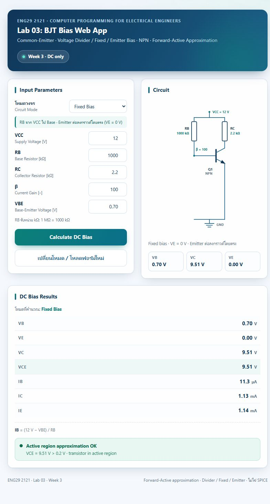

# BJT Bias Web App — Lab 03

Flask web application สำหรับคำนวณ **DC Operating Point** ของวงจร
**BJT NPN Common-Emitter** สามแบบตามใบงาน Lab 03
รายวิชา ENG29 2121 Computer Programming for Electrical Engineers (2/2569)

- **Voltage Divider Bias** — ต่อยอดจาก Lab 02 ผลลัพธ์ต้องคงเดิม
- **Fixed Bias** — ใช้ `RB` อย่างเดียว, `VE = 0 V`
- **Emitter Bias** — ใช้ `RB` และ `RE`

เลือกโหมดจากฟอร์ม กรอกค่าผ่านเบราว์เซอร์ แล้วได้
`VB`, `VE`, `VC`, `VCE` [V], `IB` [µA], `IC` และ `IE` [mA]
พร้อม validation รายโหมด และ warning เมื่อแบบจำลอง Forward-Active ใช้ไม่ได้



> ผลของ Lab 02 (Divider) ยังคงเดิมทุกค่า — ดูตาราง A1 ใน
> [`docs/lab03-acceptance.md`](docs/lab03-acceptance.md)

---

## Features

- คำนวณ DC bias จากสมการในใบงาน Lab 03 (ไม่ hardcode ผลลัพธ์)
- เลือกโหมดวงจรได้ 3 โหมด และแสดงเฉพาะช่องที่โหมดนั้นใช้
  (เปลี่ยนโหมดแล้วโหลดฟอร์มใหม่ได้โดยไม่ใช้ JavaScript)
- อินพุตตัวต้านทานเป็น **kΩ** แปลงเป็น **Ω** จุดเดียวใน `app.py`
- Validation ฝั่งเซิร์ฟเวอร์: ช่องว่าง, ไม่ใช่ตัวเลข, ค่า ≤ 0, `NaN`/`Infinity`
  โดยตรวจเฉพาะช่องที่โหมดนั้นต้องใช้
- Warning: **Cutoff** (`IB ≤ 0`) และ **Near Saturation** (`VCE ≤ 0.2 V`)
- โหมดที่ไม่รู้จัก → แจ้ง error ไม่เดาเป็น Divider
- ผลลัพธ์ระบุโหมดที่คำนวณ และไม่ค้างผลของรอบก่อนเมื่อเกิด error
- UI 3 คอลัมน์ responsive, inline SVG แยกตามโหมด, ไม่ใช้ JavaScript,
  ไม่โหลด asset จากอินเทอร์เน็ต
- Automated tests เดิม 17 รายการยังผ่านทั้งหมด (Lab 03 ไม่เพิ่ม unittest)

---

## Quick Start

ต้องมี Python 3.10 ขึ้นไป (พัฒนาบน 3.15.2) และ PowerShell

```powershell
cd BJT_DC_Bias_Web_App
python -m venv .venv
.\.venv\Scripts\Activate.ps1
python -m pip install -r requirements.txt
python -m flask --app app run --debug
```

เปิด <http://127.0.0.1:5000/>

ถ้า PowerShell ไม่ให้ activate venv ให้เรียก interpreter ตรง ๆ:

```powershell
.\.venv\Scripts\python.exe -m flask --app app run --debug
```

### รัน tests

```powershell
python -m unittest discover -s tests -v
```

ผลที่ต้องได้: `Ran 17 tests ... OK`

---

## วิธีใช้

1. เปิด `http://127.0.0.1:5000/` → ฟอร์มแสดงโหมด Voltage Divider และค่า default
2. เลือก **โหมดวงจร** จาก dropdown
   - ถ้าต้องการโหลดฟอร์มของโหมดใหม่ ให้กด **เปลี่ยนโหมด / โหลดฟอร์มใหม่**
     (ค่าที่กรอกไว้ในช่องที่โหมดใหม่ใช้จะถูกส่งต่อไปด้วย)
3. ตรวจ/แก้ค่าตามหน่วยบนฟอร์ม
4. กด **Calculate DC Bias**
5. อ่านผลในคอลัมน์ **DC Bias Results** ซึ่งระบุโหมดและสถานะ
   (Active / Cutoff / Near Saturation)

### อินพุตของแต่ละโหมด

| โหมด | ช่องที่ต้องกรอก | หมายเหตุ |
|---|---|---|
| Voltage Divider Bias | `VCC`, `R1`, `R2`, `RC`, `RE`, `β`, `VBE` | เหมือน Lab 02 |
| Fixed Bias | `VCC`, `RB`, `RC`, `β`, `VBE` | Emitter ต่อลงกราวด์ตรง ๆ, `VE = 0` |
| Emitter Bias | `VCC`, `RB`, `RC`, `RE`, `β`, `VBE` | มี `RE` จาก Emitter ลงกราวด์ |

> ฟอร์มรับ `RB` เป็น kΩ: `1 MΩ = 1000 kΩ`

### ค่าตัวอย่างและผลอ้างอิง

เงื่อนไขร่วม: `VCC = 12 V`, `RC = 2.2 kΩ`, `β = 100`, `VBE = 0.70 V`
(ค่าอ้างอิงคำนวณอิสระด้วย `Decimal` 50 หลัก — ดูที่มาใน
[`docs/lab03-acceptance.md`](docs/lab03-acceptance.md))

| โหมด | ค่าที่กรอกเพิ่ม | IC (mA) | VCE (V) | หมายเหตุ |
|---|---|---:|---:|---|
| Divider (Lab 02) | `R1=100`, `R2=22`, `RE=1` kΩ | 1.229858 | 8.052155 | A1 — ผลเดิม |
| Fixed | `RB=1000` kΩ | 1.130000 | 9.514000 | A2 |
| Emitter | `RB=1000`, `RE=1` kΩ | 1.026340 | 8.705450 | A3 |
| Emitter | `RB=1000`, `RE=2` kΩ | 0.940100 | 8.032779 | A4 — `RE` มากขึ้น → `IC` ลดลง |

ค่าเต็มของ Divider:

| ปริมาณ | ค่า |
|---|---|
| `VTH` | 2.163934 V |
| `RTH` | 18.032787 kΩ |
| `VB` | 1.942157 V |
| `VE` | 1.242157 V |
| `VC` | 9.294312 V |
| `VCE` | 8.052155 V |
| `IB` | 12.298581 µA |
| `IC` | 1.229858 mA |
| `IE` | 1.242157 mA |

---

## โมเดลและสมการ

ใช้ **Forward-Active approximation** โดยถือว่า `VBE` คงที่ตามที่ผู้ใช้กรอก
และ `β` คงที่ (ไม่คิด Early effect, อุณหภูมิ หรือ load)

```text
Fixed    IB = (VCC − VBE) / RB
Emitter  IB = (VCC − VBE) / [RB + (β + 1)·RE]
Divider  IB = (VTH − VBE) / [RTH + (β + 1)·RE]

VTH = VCC · R2 / (R1 + R2)
RTH = R1 ∥ R2 = R1·R2 / (R1 + R2)

IC  = β · IB
IE  = (β + 1) · IB
VE  = IE · RE   (Fixed: VE = 0 V)
VB  = VE + VBE
VC  = VCC − IC · RC
VCE = VC − VE
```

### หน่วย

| ชั้น | หน่วย |
|---|---|
| ฟอร์มและ SVG | `VCC`, `VBE` เป็น V; `R1`, `R2`, `RB`, `RC`, `RE` เป็น kΩ |
| `dc_bias.py` | SI ล้วน: V และ Ω |
| `app.py` | แปลง kΩ → Ω (`×1000`) จุดเดียวใน `_parse_inputs()` |

การแสดงผล: V ทศนิยม 2 ตำแหน่ง, mA 2 ตำแหน่ง, µA 1 ตำแหน่ง
(คำนวณด้วยความละเอียดเต็มแล้ว format ตอนแสดงเท่านั้น)

---

## Validation และ Warning

| เงื่อนไข | พฤติกรรม |
|---|---|
| ช่องว่าง หรือแปลงเป็นตัวเลขไม่ได้ | inline error “กรุณากรอกค่าตัวเลขให้ครบทุกช่อง” (HTTP 200) |
| `VCC ≤ 0` | error “VCC ต้องมากกว่า 0” |
| Divider: `R1`, `R2`, `RC`, `RE` ≤ 0 | error “R1, R2, RC, RE ต้องมากกว่า 0” |
| Fixed: `RB`, `RC` ≤ 0 | error “RB, RC ต้องมากกว่า 0” |
| Emitter: `RB`, `RC`, `RE` ≤ 0 | error “RB, RC, RE ต้องมากกว่า 0” |
| `β ≤ 0` | error “β ต้องมากกว่า 0” |
| `VBE ≤ 0` | error “VBE ต้องมากกว่า 0” |
| `NaN` หรือ `Infinity` (หรือค่าที่ล้นจนคำนวณไม่ได้) | error “ค่าอินพุตต้องเป็นจำนวนจำกัด …” |
| `IB ≤ 0` | warning **Cutoff** — Forward-Active approximation ใช้ไม่ได้ |
| `VCE ≤ 0.2 V` | warning **Near Saturation** — ผลอาจไม่แม่นยำ |
| `mode` ที่ไม่รู้จัก | error “ไม่รู้จักโหมดวงจรที่เลือก …” และไม่คำนวณ |

> **หมายเหตุ:** เกณฑ์ `VCE ≤ 0.2 V` เป็น **heuristic assumption**
> จากภาพตัวอย่างในเอกสาร ไม่ใช่ตัวเลขที่ใบงานกำหนด
> และไม่กระทบการคำนวณ กระทบเฉพาะข้อความ warning เท่านั้น
>
> `IB ≤ 0` ให้ผลเหมือน `VTH ≤ VBE` ในโหมด Divider จึงยังตรงกับ warning
> ที่ใช้ใน Lab 02

เมื่อแบบจำลองอยู่นอก Forward-Active ค่าที่คำนวณได้ (เช่น `IB`/`IC` ติดลบ)
จะยังถูกแสดงตามสมการ แต่จะติด warning และไม่รายงานว่า Active

---

## โครงสร้างโปรเจกต์

```
BJT_DC_Bias_Web_App/
├── app.py                     # Flask routes, mode dispatch, form parsing, kΩ → Ω
├── dc_bias.py                 # engineering core: divider / fixed / emitter (SI units)
├── requirements.txt           # Flask==3.1.3
├── templates/
│   └── index.html             # server-rendered page, mode selector, inline SVG
├── static/
│   └── style.css              # responsive 3-column layout
├── tests/
│   ├── test_dc_bias.py        # 10 engineering tests (Lab 02, unchanged)
│   └── test_web.py            # 7 Flask client tests (Lab 02, unchanged)
├── docs/
│   ├── design-note.md         # Lab 02 design + Lab 03 delta
│   ├── validation.md          # Lab 02 validation
│   ├── lab03-acceptance.md    # Lab 03: A1–A5, independent calc, browser log
│   ├── reflection.md
│   ├── screenshot.png         # Lab 02 screenshot
│   ├── lab03-fixed-bias.jpeg
│   ├── lab03-emitter-bias.jpeg
│   ├── lab03-input-error.jpeg
│   ├── test-log.txt
│   ├── test-log-lab03.txt
│   └── superpowers/plans/     # implementation plan
├── AGENTS.md
└── README.md
```

---

## ขอบเขต

อยู่ในขอบเขต (Lab 03):

- DC bias ของ BJT NPN Common-Emitter: Divider / Fixed / Emitter
- Forward-Active approximation
- Server-side validation รายโหมด, warning, และการเลือกฟังก์ชันตามโหมด

**ไม่อยู่ในขอบเขต:** AC analysis, transient, Bode plot, signal generator,
SPICE/ngspice, FET, interactive schematic, DC load line,
และการเขียน unittest ใหม่สำหรับ Lab 03 (ตรวจผ่าน browser แทน)

---

## เอกสารและหลักฐาน

- [Lab 03 Acceptance](docs/lab03-acceptance.md) — ค่าอ้างอิงอิสระ, ตาราง A1–A5, วิธีตรวจ, MCP
- [Design Note](docs/design-note.md) — ข้อกำหนดและการตัดสินใจ
- [Validation (Lab 02)](docs/validation.md) — คำนวณอิสระ, ผลทดสอบ, checklist A1–A7
- [Reflection](docs/reflection.md) — คำตอบคำถามรายบุคคล
- [Test Log](docs/test-log.txt) — output ของ unittest (Lab 02)
- [Test Log Lab 03](docs/test-log-lab03.txt) — output ของ unittest หลังเพิ่มโหมด

---

## Submission (Lab 03)

- **Repository:** <https://github.com/b6827311-oss/-ENG29_2121_Lab03_BJT_Bias_Web_App>
- **Branch:** `main`
- **Commit SHA (Lab 03):** `eb8b6ab1751edce26be8fd02333a6023aa66db14`
  (`eb8b6ab` — *feat: add Lab 03 fixed and emitter bias modes with acceptance evidence*)
- **วิธีรัน:** ดู Quick Start ด้านบน
- **ส่วนที่ AI ช่วย:** ฟังก์ชัน Fixed/Emitter, dispatch ตามโหมด, ฟอร์มเลือกโหมด,
  เอกสารและตาราง A1–A5 — นักศึกษาตรวจสมการ/หน่วย/warning และผล A1–A5
  (รายละเอียดใน [`docs/lab03-acceptance.md`](docs/lab03-acceptance.md) §3)

---

## Troubleshooting

| อาการ | วิธีแก้ |
|---|---|
| `flask: command not found` | เปิด venv ก่อน หรือใช้ `.\.venv\Scripts\python.exe -m flask ...` |
| `ModuleNotFoundError: No module named 'flask'` | `python -m pip install -r requirements.txt` |
| port 5000 ถูกใช้อยู่ | ปิดโปรเซสเดิม หรือ `python -m flask --app app run --debug --port 5001` |
| หน้าเว็บไม่มีสี | ตรวจว่า Flask เสิร์ฟ `/static/style.css` ได้ (hard refresh) |
| เปลี่ยนโหมดแล้วช่องไม่เปลี่ยน | กด **เปลี่ยนโหมด / โหลดฟอร์มใหม่** ก่อนกรอกค่า |
| เปลี่ยนค่าแล้วผลไม่เปลี่ยน | กด **Calculate DC Bias** และรอหน้าใหม่ — ดูวิธีไล่ข้อมูลใน `docs/lab03-acceptance.md` §6 |
